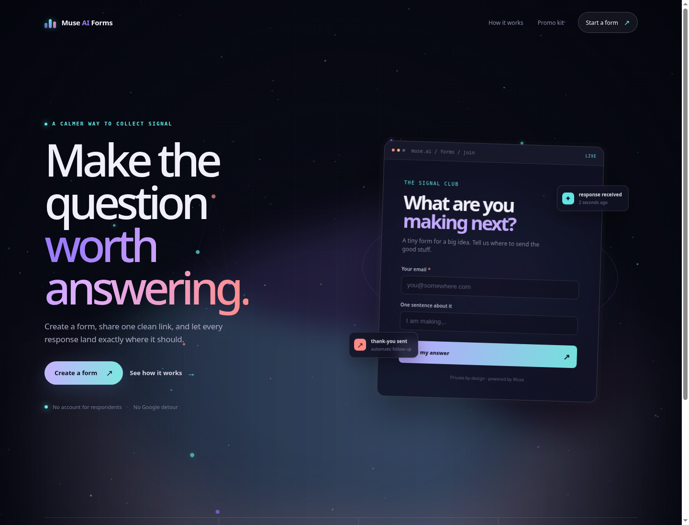
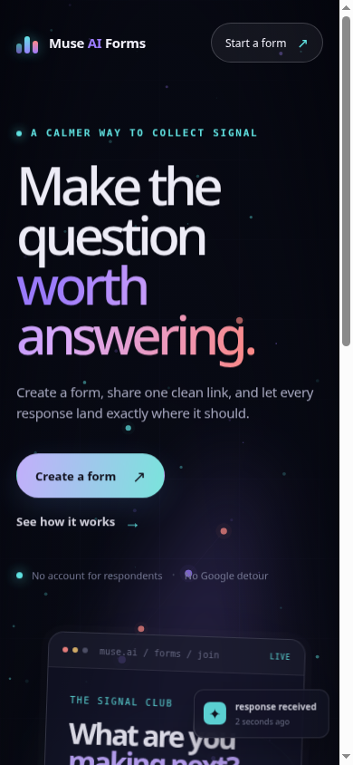
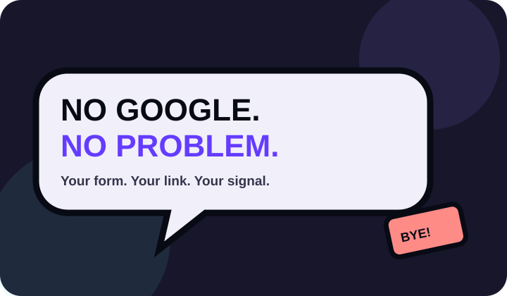
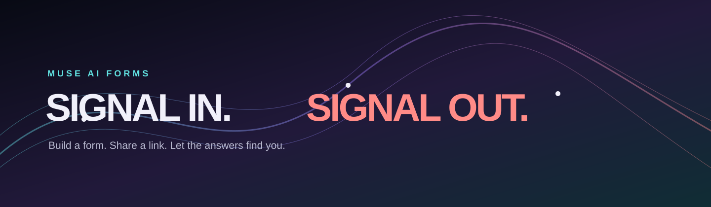
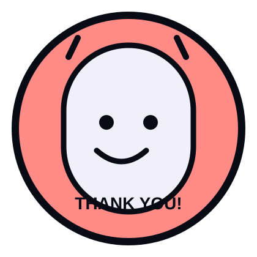
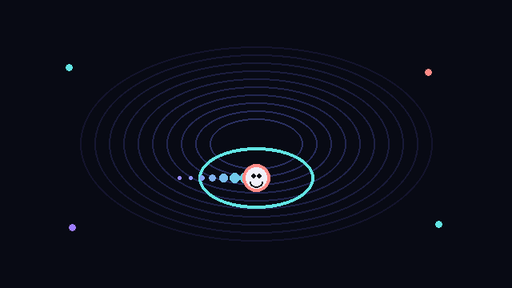

# Muse AI Forms — Signal Field

A dark, animated, dependency-free visual system for the Muse AI Forms concept: a calmer alternative to generic form tools where people can build a form, share one clean link, collect responses, understand the signal, and follow up automatically.

This package is a **static file bundle**. It is intended to be copied into a GitHub Pages repository or deployed through Cloudflare Pages/Workers. It does not create, require, or publish a Manus-hosted website.

## What the finished page looks like

### Desktop preview



The landing page uses a quiet ink background, restrained particles, a responsive form preview, floating response notifications, and a focused two-column composition. The animation is there to create atmosphere; the actual message and calls to action remain regular HTML.

### Mobile preview



The layout collapses into a readable single-column flow on smaller screens. Navigation becomes compact, the form preview scales down, and the feature strip turns into a two-column mobile grid.

## Visual language

The visual direction is intentionally dark and editorial rather than neon-heavy:

- **Ink base:** `#080a14` and deep blue-black surfaces.
- **Signal violet:** used for emphasis, links, and the “worth answering” message.
- **Signal cyan:** used for live states, active dots, and system feedback.
- **Signal coral:** used sparingly for human moments such as thank-you states and response accents.
- **Soft glass surfaces:** translucent panels with thin borders and restrained blur.
- **Motion with purpose:** floating form preview, gentle orbit lines, particles, and status cards.
- **HTML-first content:** the background canvas is decorative; headings, links, labels, and form content remain accessible and indexable HTML.

## Included screenshots and assets

### Symbol-only favicon

The favicon is a symbol, not a letter. It is an orbit-and-signal mark that remains recognizable at small sizes.


Use it with:

```html
<link rel="icon" type="image/svg+xml" href="assets/favicon.svg" />
```

### Logo


### Comic promotion: no Google



### Comic promotion: every answer counts


### Wide banner



### Thank-you sticker



### Animated GIF



The GIF is an actual 18-frame looping animation, not a still image with a filename changed. It is suitable for a social post, a playful loading state, a launch page, or a lightweight email/promo placement.

## File tree

```text
Muse-AI-Forms-Animated-Background/
├── README.md
├── assets/
│   ├── banner-signal-in.svg       # Wide campaign banner
│   ├── favicon.svg                # Symbol-only browser favicon
│   ├── logo.svg                   # Full Muse AI Forms logo
│   ├── promo-every-answer.svg     # Comic response-counting promo
│   ├── promo-no-google.svg        # Comic no-Google promo
│   ├── signal-orbit.gif           # 18-frame looping animation
│   └── sticker-thank-you.svg      # Friendly thank-you sticker
├── demo/
│   ├── create.html                # Real destination for Create a form links
│   ├── gallery.html               # Real destination for Promo kit links
│   ├── how-it-works.html          # Real destination for product-story links
│   └── index.html                 # Main landing page
├── docs/
│   ├── preview-desktop.png        # Rendered desktop README preview
│   └── preview-mobile.png         # Rendered mobile README preview
└── src/
    ├── muse-forms-background.css  # Layout, visual system, responsive effects
    └── muse-forms-background.js   # Canvas particles, aurora, nodes, parallax
```

## Route map

Every primary CTA and navigation item resolves to an actual local HTML file. There are no dead “button-looking” text elements in the demo.

| Page | File | Purpose |
| --- | --- | --- |
| Home | `demo/index.html` | Main landing page with form preview and feature strip |
| Create a form | `demo/create.html` | Static builder destination prepared for future form functionality |
| How it works | `demo/how-it-works.html` | Explains collect, understand, and follow up |
| Promo kit | `demo/gallery.html` | Displays the included SVG, logo, sticker, banner, and GIF assets |

All pages include the same symbol favicon, animated background, shared stylesheet, and local relative asset references.

## Run it locally

No package manager, build tool, API key, server, or external font is required.

### Option 1: open the file

Open `demo/index.html` in a browser. Relative links and assets are designed to work from the local file system.

### Option 2: use a tiny local server

A local server more closely matches static hosting behavior:

```bash
cd Muse-AI-Forms-Animated-Background
python3 -m http.server 8080
```

Then open:

```text
http://localhost:8080/demo/index.html
```

## Use the background on another page

Add the stylesheet and script, then place a `.muse-bg` layer behind your content:

```html
<link rel="icon" type="image/svg+xml" href="assets/favicon.svg" />
<link rel="stylesheet" href="src/muse-forms-background.css" />

<div class="muse-page">
  <div class="muse-bg" aria-hidden="true"></div>
  <main class="content">
    <h1>Your page content</h1>
  </main>
</div>

<script src="src/muse-forms-background.js"></script>
```

The script automatically mounts to every `.muse-bg` element. It can also be configured manually:

```js
MuseFormsBackground.mount(document.querySelector('.muse-bg'), {
  density: 0.85,
  speed: 0.75,
  interactive: true,
  seed: 27,
  nodeCount: 12
});
```

### Animation options

| Option | Default | Effect |
| --- | ---: | --- |
| `density` | `1` | Multiplies the number of background particles. |
| `speed` | `1` | Multiplies aurora, particle, and node animation speed. |
| `interactive` | `true` | Enables cursor parallax on pointer-capable devices. |
| `seed` | `27` | Keeps the particle and node composition deterministic. |
| `nodeCount` | `12` | Controls the number of signal nodes and constellation points. |

## How the animation works

The background is rendered with a single responsive HTML canvas:

1. A deterministic seeded random generator creates particles and form-like signal nodes.
2. Three low-contrast aurora bands move at different speeds and frequencies.
3. Nearby nodes connect with faint lines to suggest private information flow.
4. Pointer position gently shifts the particle field and nodes for depth.
5. A CSS grid, vignette, and glow layers add structure without competing with the page.
6. The canvas is capped at a device pixel ratio of `2` to avoid unnecessary GPU load.

The animation deliberately avoids external libraries and network calls.

## Accessibility and reduced motion

The background canvas is decorative and carries `aria-hidden="true"`. Important content is not painted into the canvas, so headings and actions remain selectable, readable, and indexable.

When the visitor has enabled `prefers-reduced-motion: reduce`:

- Canvas time stops on a calm static composition.
- Pointer parallax is effectively disabled.
- Entrance animations and floating cards stop.
- Hover transitions are reduced or removed.

The page still works as a normal static HTML experience.

## GitHub Pages deployment

1. Copy the package contents into the repository you want to publish.
2. Keep `assets/`, `src/`, and `demo/` at the same relative level.
3. Choose a Pages source that includes the folder containing all three directories.
4. If you want the landing page at the site root, copy the contents of `demo/` into the repository’s published root while keeping `assets/` and `src/` beside the HTML files.
5. Preserve the relative paths, especially `../assets/favicon.svg`, `../src/muse-forms-background.css`, and `../src/muse-forms-background.js` when the HTML files remain inside `demo/`.

For a root deployment, the simplest structure is:

```text
published-root/
├── assets/
├── src/
├── index.html
├── create.html
├── how-it-works.html
└── gallery.html
```

If you move the HTML files out of `demo/`, change their asset paths from `../assets/...` to `assets/...` and from `../src/...` to `src/...`.

## Cloudflare Pages or Workers deployment

### Cloudflare Pages

Use the folder containing the published HTML files as the output directory. The deployment must include:

- All `.html` routes.
- The `assets/` directory.
- The `src/` directory.
- The `docs/` directory only if you want the preview images publicly available.

Cloudflare Pages serves the files as static assets. Keep the explicit `.html` destinations if you want links to behave consistently on both GitHub Pages and Cloudflare Pages.

### Cloudflare Worker with static assets

For a Worker that serves static assets, bind the static asset directory to the folder that contains `assets/`, `src/`, and the HTML routes. Avoid turning every missing file into a plain-text response. If you later add SPA-style rewrites, keep explicit handling for the existing `.html` routes and static assets first.

## Customization guide

### Change the palette

Edit the variables at the top of `src/muse-forms-background.css`:

```css
:root {
  --ink: #080a14;
  --paper: #f1f0fa;
  --muted: #a9aac2;
  --violet: #9d7cff;
  --cyan: #62e5e4;
  --coral: #ff8b87;
}
```

### Change the headline

The hero copy is ordinary HTML in `demo/index.html`, so it can be edited without touching the animation engine:

```html
<h1>Make the question<br /><em>worth answering.</em></h1>
```

### Replace promotional artwork

The promo cards use regular image elements. Replace an SVG or GIF in `assets/` and keep the same filename, or update the `src` attribute in `demo/gallery.html` and `demo/index.html`.

### Make the background calmer

Use a lower animation speed and particle density:

```js
MuseFormsBackground.mount(document.querySelector('.muse-bg'), {
  density: 0.55,
  speed: 0.45,
  interactive: false
});
```

## Troubleshooting

### The favicon does not appear

Confirm that the HTML file contains:

```html
<link rel="icon" type="image/svg+xml" href="../assets/favicon.svg" />
```

If the HTML file has been moved from `demo/` to the published root, use `assets/favicon.svg` instead.

### The background is missing

Check that the browser can resolve both `muse-forms-background.css` and `muse-forms-background.js`. Open the browser’s network panel and confirm that the relative paths match the final published folder structure.

### Images are broken after deployment

The package uses relative paths on purpose. Do not flatten only the HTML files without also moving `assets/` and `src/` or updating the relative paths.

### The animation feels too strong

Lower `speed` and `density`, or rely on the built-in reduced-motion behavior. The canvas is decorative and can be removed entirely without removing the page content.

## Validation status

The package has been checked for:

- JavaScript syntax errors.
- Existing local HTML route targets.
- Favicon presence on every demo page.
- Local CSS, JavaScript, SVG, GIF, and image references.
- Valid SVG parsing.
- Multi-frame GIF output.
- ZIP archive integrity.

## License

Use, modify, remix, and adapt this package freely for the Muse AI Forms project and related prototypes.
